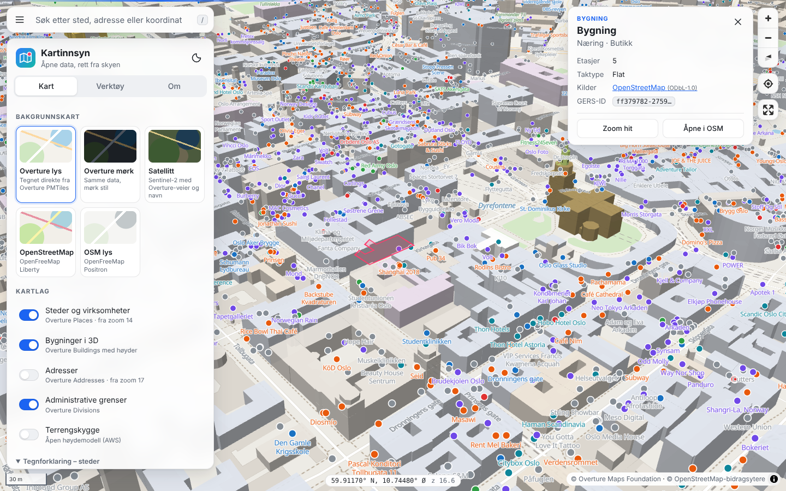
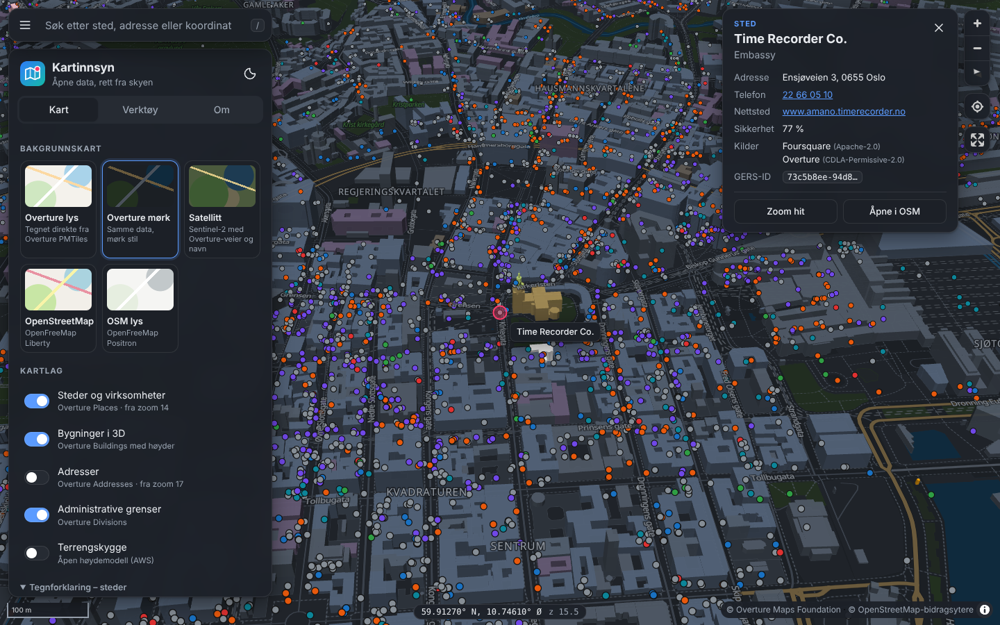
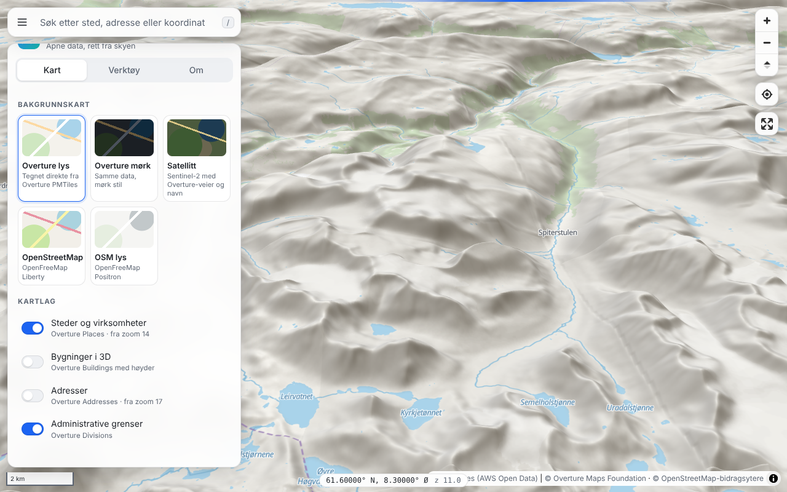
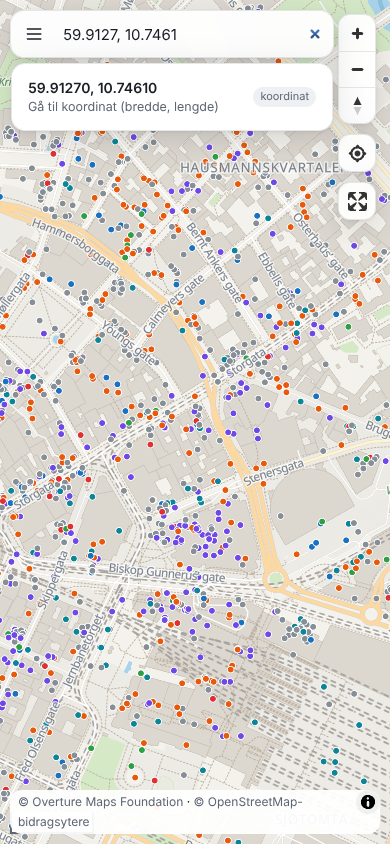

# Kartinnsyn

Et åpent kartinnsyn bygget på skybasert (cloud native) geodatateknologi. Appen er
helt statisk. Kartdata leses direkte fra åpne **PMTiles**-arkiver i objektlagring
med HTTP-områdeforespørsler, så det trengs ingen flisserver, database, backend
eller API-nøkkel.



| Mørk modus | 3D-terreng | Mobil |
| --- | --- | --- |
|  |  |  |

## Funksjoner

| Område | Hva |
| --- | --- |
| Bakgrunnskart | **Overture lys/mørk** tegnes i nettleseren rett fra Overture-dataene. **Satellitt** (Sentinel‑2) med Overture-veier og -navn. **OpenStreetMap** via OpenFreeMap (Liberty og Positron). |
| Kartlag | Steder og virksomheter (Overture Places, fargelagt etter kategori), bygninger i 3D med ekte høyder og bygningsdeler, adresser, administrative grenser og terrengskygge. |
| 3D | Skråvisning, 3D-bygninger, 3D-terreng med åpen høydemodell, globusprojeksjon og himmel/atmosfære. |
| Søk | Adresser og steder (Photon/OSM), Overture-steder som allerede er lastet i kartet (lokalt søk) og koordinater. Piltaster og Enter fungerer i trefflisten. |
| Objektinfo | Klikk på et objekt for å se navn, kategori, adresse, telefon, nettsted, høyde og etasjer, kildesporing per datasett med lisens, lenke til OSM-objektet og Overtures globale **GERS-ID**. |
| Måling | Avstand og areal på jordkula (m, km, m², daa, km²), med angre og ferdig. |
| Deling | Hele visningen (posisjon, bakgrunnskart, lag, 3D, terreng og globus) ligger i URL-en. «Del lenke» bruker systemets delingsdialog på mobil. |
| Eksport | Lagre kartbilde som PNG med kildehenvisning, skrive ut, eller laste ned et **GeoLibre-prosjekt** (`.geolibre.json`). |
| Brukeropplevelse | Lyst og mørkt tema som følger systemet, mobiltilpasset bunnark, hurtigtaster, min posisjon med sporing, fullskjerm, målestokk, koordinatvisning med kopiering, lastestripe og PWA som kan installeres. Grensesnittet er tilgjengelig med ARIA-roller, tastaturnavigasjon og redusert bevegelse. |

### Hurtigtaster

`/` søk · `M` mål avstand · `A` mål areal · `3` bytt mellom 2D og 3D · `Esc` avbryt eller lukk

## Teknologi

- **[MapLibre GL JS](https://maplibre.org) 6**: åpen kildekode-kartmotor (WebGL), med globus, terreng og 3D.
- **[PMTiles](https://protomaps.com/docs/pmtiles)**: én fil per datasett i objektlagring, lest med HTTP Range-forespørsler.
- **[Overture Maps](https://overturemaps.org)**: åpne globale kartdata (bygninger, steder, adresser, transport, inndelinger, arealdekke og vann) som samler OpenStreetMap, Meta, Microsoft, Esri og flere kilder.
- **[GeoLibre](https://geolibre.app)**: prosjekteksporten bygges med GeoLibres egne pakker (`@geolibre/core` og `@geolibre/map`), så filen følger GeoLibres prosjektformat og kan åpnes direkte i GeoLibre for videre analyse (DuckDB, GeoParquet, prosessering). Pakkene lastes først når man trykker på eksport.
- **[OpenFreeMap](https://openfreemap.org)**: OSM-bakgrunnskart uten API-nøkkel.
- **Photon**: åpen kildekode-geokoder basert på OpenStreetMap.
- **Vite og TypeScript**: bygget er rene statiske filer.

### Skyprinsipper

- **Ingen tjenere å drifte.** Appen er statiske filer, og dataene er statiske arkiver i objektlagring. Det skalerer med CDN, uten servere som må skaleres.
- **Alltid ferske data.** Appen lister Overture-bøtta (S3 `ListObjectsV2`) ved oppstart og bruker nyeste utgave automatisk. En bestemt utgave kan låses med `?release=2026-09-23.1`.
- **Tilstand i URL-en.** Ingen sesjoner på serversiden; en lenke gjenskaper visningen nøyaktig.
- **Selvhostede glyfer.** Noto Sans (SIL OFL) ligger i `public/fonts`, så etiketter ikke er avhengige av tredjepart.
- **Kan kjøres offline.** En service worker cacher appskallet. Kartdata hentes alltid ferskt.
- **Ingen innlåsing.** Alt er åpen kildekode og åpne data. Kildene ligger i `src/config.ts` og kan pekes mot egne PMTiles-filer, for eksempel i egen bøtte eller på eget CDN.

## Kom i gang

```bash
cd kartinnsyn
npm install
npm run dev       # utviklingsserver på http://localhost:5173
npm run build     # typesjekk og produksjonsbygg til dist/
npm run preview   # server dist/ lokalt
```

## Publisering

`dist/` kan legges på hvilken som helst statisk hosting: GitHub Pages, Cloudflare Pages,
Netlify, en S3- eller Azure-bøtte bak CDN, eller nginx. Bygget bruker relative stier og
virker derfor i en undermappe.

Repoet har en ferdig arbeidsflyt (`.github/workflows/kartinnsyn-pages.yml`) som bygger og
publiserer til GitHub Pages ved push til `main`. Den må slås på én gang under
**Settings → Pages → Source: GitHub Actions**.

## Struktur

```
src/
  main.ts       kart, grensesnitt, verktøy og hurtigtaster
  style.ts      MapLibre-stil bygget fra Overture PMTiles (lys, mørk og satellitt) og kartlag
  config.ts     datakilder og oppslag av nyeste Overture-utgave
  info.ts       lesbar objektinfo fra Overture-attributter
  search.ts     koordinater, lokalt søk i Overture-steder og Photon
  measure.ts    avstand og areal på kula
  state.ts      tilstand i URL-en
  geolibre.ts   eksport til GeoLibre-prosjekt
  app.css       design (lyst og mørkt, mobil og utskrift)
public/
  fonts/        Noto Sans-glyfer (PBF)
  sw.js         service worker
```

## Data og lisenser

- Overture Maps Foundation: ODbL 1.0 (OSM-avledet), CDLA Permissive 2.0 og CC BY 4.0 avhengig av tema. Se [Overtures attribusjonskrav](https://docs.overturemaps.org/attribution/).
- © OpenStreetMap-bidragsytere (ODbL).
- Sentinel‑2 cloudless av EOX IT Services GmbH (CC BY‑NC‑SA 4.0). Tillatt for ikke-kommersiell bruk.
- Høydedata: Terrain Tiles på AWS Open Data (Mapzen; SRTM, GMTED, ETOPO1 m.fl.).
- Noto Sans: SIL Open Font License.

Kildekoden er MIT-lisensiert.
